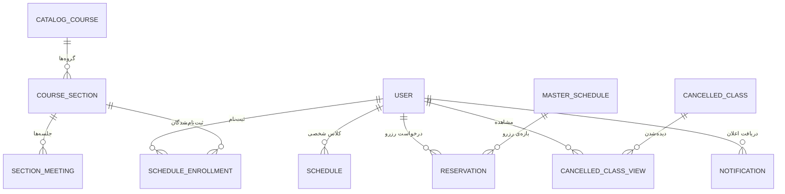

# UniNet Dashboard

سامانه‌ی «داشبورد کلاس» برای دانشجویان دانشگاه؛ بخشی از پلتفرم دانشجویی UniNet که به‌صورت یک پروژه‌ی مستقل و تک‌فایلی (monolith) جدا شده است. این سامانه با Flask، SQLAlchemy، SQLite و Socket.IO ساخته شده و مدیریت برنامه‌ی هفتگی کلاس‌ها را با پشتیبانی از هفته‌های فرد و زوج، تاریخ جلالی، کاتالوگ دروس (درس، گروه، جلسه)، اعلان لغو کلاس، رزرو اتاق، اعلان‌ها و به‌روزرسانی لحظه‌ای فراهم می‌کند. علاوه بر پنل کاربر، یک پنل مدیریت کامل هم دارد.


## این پروژه چه کاری انجام می‌دهد

هر دانشجو برنامه‌ی هفتگی خودش را در یک شبکه‌ی «روز × بازه‌ی زمانی» می‌بیند. کلاس‌ها دو منبع دارند: کلاس‌های شخصی که خود دانشجو وارد می‌کند، و گروه‌هایی که از کاتالوگ دروس انتخاب می‌کند. مدیر کاتالوگ را فقط یک‌بار ثبت می‌کند و دانشجو فقط «ارجاع» به گروه را نگه می‌دارد، بنابراین هر ویرایش مدیر بلافاصله در برنامه‌ی همه‌ی دانشجویان ثبت‌نام‌شده اعمال می‌شود و برایشان اعلان می‌رود.

### جریان کار دانشجو (پنل کاربر)

1. ثبت‌نام یا ورود از صفحه‌ی `/auth` با شماره‌ی دانشجویی (۱۰ رقم) و کد ملی (۱۰ رقم) به‌عنوان رمز عبور.
2. ورود به داشبورد `/dashboard` و دیدن برنامه‌ی هفتگی، تاریخ امروز، کلاس‌های لغوشده‌ی امروز و اعلان‌های خوانده‌نشده.
3. افزودن، ویرایش و حذف کلاس شخصی، یا ثبت‌نام در گروه‌های کاتالوگ با تشخیص تداخل زمانی.
4. وارد کردن یک‌جای برنامه از روی متن کپی‌شده از اکسل.
5. دیدن فهرست کلاس‌های لغوشده و علامت‌گذاری آن‌ها به‌عنوان «دیده‌شده».
6. ثبت درخواست رزرو اتاق خالی و پیگیری وضعیت آن (در انتظار، تأییدشده، ردشده).
7. تنظیم تاریخ شروع ترم (برای تشخیص هفته‌ی فرد و زوج) و مرور اعلان‌ها از زنگوله‌ی بالای صفحه.

### جریان کار مدیر (پنل مدیریت)

1. ورود به `/admin` با حساب `admin`. این حساب در اولین اجرا خودکار ساخته می‌شود و رمز تصادفی آن فقط یک‌بار در کنسول چاپ می‌شود.
2. تنظیم برنامه‌ی اصلی اتاق‌ها (master schedule) برای هر روز و بازه‌ی زمانی.
3. تأیید یا رد درخواست‌های رزرو دانشجویان.
4. ثبت و حذف اعلان لغو کلاس (با تاریخ تکی یا بازه‌ی تاریخی شمسی).
5. مدیریت کاتالوگ: درس، گروه و جلسه، همراه با ورود و خروج متنی، تعیین ترم فعال و تاریخ شروع ترم.
6. افزودن و حذف تعطیلی روی تقویم.

رزروهای اتاق هر هفته (با تغییر هفته‌ی ISO) خودکار پاک می‌شوند تا جدول رزرو برای هفته‌ی جدید خالی شود.

## امکانات

### پنل کاربر

- شبکه‌ی برنامه‌ی هفتگی از شنبه تا چهارشنبه با شش بازه‌ی دوساعته (۸ تا ۲۰).
- پشتیبانی از کلاس «هر هفته»، «فرد» و «زوج»، بر پایه‌ی تاریخ شروع ترم که دانشجو تنظیم می‌کند (در غیر این صورت مقدار پیش‌فرضِ مدیر استفاده می‌شود).
- کلاس‌های شخصی: افزودن، ویرایش و حذف، با واحد درسی اختیاری.
- جست‌وجوی کاتالوگ با نام فارسی نرمال‌شده (یکسان‌سازی «ي/ی» و «ك/ک»، نیم‌فاصله و ارقام)، کد درس و شماره‌ی گروه.
- ثبت‌نام در گروه با تشخیص تداخل زمانی (با تأیید کاربر)، جایگزینی گروه یا درس و حذف ثبت‌نام.
- محاسبه‌ی خودکار مجموع واحدها.
- وارد کردن یک‌جای برنامه از متن اکسل، با اعتبارسنجی هر ردیف و گزارش ردیف‌های ردشده.
- نمایش کلاس‌های لغوشده‌ی امروز، شمارنده‌ی «دیده‌نشده» و علامت‌گذاری مشاهده.
- درخواست رزرو اتاق با ذکر دلیل؛ اتاق‌های تأییدشده از فهرست اتاق‌های خالی حذف می‌شوند.
- اعلان‌ها با امکان علامت‌گذاری تکی یا همگانی به‌عنوان خوانده‌شده.
- به‌روزرسانی لحظه‌ای برنامه با رویداد `catalog_updated` در Socket.IO.
- تاریخ جلالی و تقویم تعطیلات رسمی.

### پنل مدیریت

- ویرایش master schedule با همگام‌سازی ردیفی، به‌طوری که ردیف‌هایی که رزرو به آن‌ها اشاره می‌کند حذف نشوند.
- تأیید یا رد رزرو؛ با تأیید یک درخواست، درخواست‌های در انتظارِ همان اتاق و بازه رد می‌شوند و برای دانشجو اعلان می‌رود.
- ثبت و حذف لغو کلاس.
- مدیریت کاتالوگ (ایجاد، ویرایش و حذف درس، گروه و جلسه).
- هشدار غیرمسدودکننده هنگام هم‌پوشانی استاد یا مکان در بازه‌ی یکسان.
- حذف نرم (`is_active`) برای درس، گروه یا جلسه‌ای که دانشجو در آن ثبت‌نام کرده، با درخواست تأیید و اعلان به دانشجویان.
- ورود (پیش‌نمایش و ثبت) و خروج متنی کاتالوگ در یک قالب استاندارد.
- تعیین ترم فعال و تاریخ پیش‌فرض شروع ترم.
- افزودن و حذف تعطیلی روی تقویم.


## پشته‌ی فناوری

| لایه | ابزار |
|---|---|
| زبان | Python |
| فریم‌ورک وب | Flask |
| ORM | Flask-SQLAlchemy و SQLAlchemy |
| دیتابیس | SQLite (پیش‌فرض)؛ PostgreSQL از طریق `DATABASE_URL` |
| مهاجرت دیتابیس | Flask-Migrate، به‌علاوه‌ی افزودن خودکار ستون‌های جدید (`ADD COLUMN`) در شروع برنامه |
| زمان واقعی | Flask-SocketIO در حالت `threading`، و کلاینت Socket.IO از CDN |
| فرم و CSRF | Flask-WTF |
| محدودیت نرخ درخواست | Flask-Limiter (ذخیره در حافظه) |
| تاریخ جلالی | jdatetime |
| قالب‌ها | Jinja2 |
| فرانت‌اند | HTML، CSS و JavaScript ساده (بدون فریم‌ورک)؛ فونت Vazirmatn و Material Icons Round از CDN |
| منطقه‌ی زمانی | `zoneinfo` با `Asia/Tehran` (روی ویندوز به بسته‌ی `tzdata` نیاز دارد) |
| هش رمز عبور | `pbkdf2:sha256` (Werkzeug) |

نسخه‌ی دقیق همه‌ی بسته‌ها در `requirements.txt` قفل شده است.

دیتابیس پیش‌فرض **SQLite** است. فایل `app.db` در اولین اجرا کنار `app.py` ساخته می‌شود و در مخزن وجود ندارد. با تنظیم `DATABASE_URL` می‌توان از PostgreSQL استفاده کرد (نشانی‌های `postgres://` خودکار به `postgresql://` تبدیل می‌شوند). این مخزن هیچ دیتابیس و هیچ داده‌ی کاربری ندارد.

</div>

<div dir="rtl">

## دیتابیس

جدول‌ها (برگرفته از مدل‌های `app.py`):

</div>

<div dir="rtl">

| جدول | توضیح |
|---|---|
| `user` | کاربران (دانشجو و مدیر)؛ شماره‌ی دانشجویی یکتا، هش رمز و نقش مدیر |
| `schedule` | کلاس‌های شخصی دانشجو (روز، بازه، نام درس، استاد، مکان، نوع هفته، واحد اختیاری) |
| `master_schedule` | برنامه‌ی اصلی اتاق‌ها؛ برای هر روز و بازه، فهرست اتاق‌های قابل رزرو |
| `reservation` | درخواست رزرو اتاق با وضعیت `pending`، `approved` یا `rejected` |
| `cancelled_class` | اعلان لغو کلاس (استاد، درس، بازه، تاریخ یا بازه‌ی تاریخی، توضیح) |
| `cancelled_class_view` | ثبت اینکه کدام کاربر کدام اعلان لغو را دیده است |
| `notification` | اعلان‌های هر کاربر |
| `system_setting` | تنظیمات کلید و مقدار (ترم فعال، تاریخ شروع ترم، تنظیم شخصی شروع ترم هر کاربر، آخرین هفته‌ی بازنشانی رزروها) |
| `holiday_overrides` | تعطیلی‌های افزوده یا حذف‌شده توسط مدیر |
| `catalog_course` | درس در کاتالوگ (کد یکتا، نام، واحد، رشته) |
| `course_section` | گروه یک درس در یک ترم (استاد، مکان پیش‌فرض، حذف نرم) |
| `section_meeting` | جلسه‌ی هفتگی یک گروه (روز، ساعت شروع و پایان، نوع هفته، مکان جایگزین، حذف نرم) |
| `schedule_enrollment` | ثبت‌نام دانشجو در یک گروه؛ فقط ارجاع است و داده‌ای کپی نمی‌شود |


نمودار ER:




جدول‌های `system_setting` و `holiday_overrides` به جدول دیگری وابسته نیستند.

جدول‌ها و اولین کاربر مدیر (`student_id=admin`، با رمز تصادفی که فقط یک‌بار در کنسول چاپ می‌شود) در اولین اجرا با `db.create_all()` ساخته می‌شوند. هیچ داده‌ای همراه مخزن نیست.

## ساختار پروژه

</div>

```
uninet-dashboard/
├── app.py                  # کل برنامه: مدل‌ها، مسیرها، Socket.IO و راه‌اندازی
├── requirements.txt        # وابستگی‌ها با نسخه‌ی قفل‌شده
├── .env.example            # نمونه‌ی متغیرهای محیطی
├── .gitignore
├── README.md
├── data/                   # فایل‌های iran_holidays_<سال>.json برای تقویم تعطیلات
├── static/                 # فایل‌های CSS، JS و تصاویر
└── templates/              # قالب‌های Jinja2 (راست‌به‌چپ، فارسی)
    ├── base.html
    ├── index.html
    ├── register.html
    ├── dashboard.html
    ├── admin_dashboard.html
    └── error.html
```

## متغیرهای محیطی


| متغیر | مقدار پیش‌فرض | توضیح |
|---|---|---|
| `SECRET_KEY` | `uninet-dashboard-dev-secret-change-me` | کلید امضای نشست؛ مقدار پیش‌فرض فقط برای توسعه است |
| `DATABASE_URL` | `sqlite:///<پوشه‌ی پروژه>/app.db` | نشانی دیتابیس (SQLite یا PostgreSQL) |
| `HOST` | `127.0.0.1` | میزبان سرور |
| `PORT` | `5001` | درگاه سرور |
| `FLASK_DEBUG` | `false` | با مقدار `true` حالت اشکال‌زدایی فعال می‌شود |
| `SOCKETIO_ALLOWED_ORIGINS` | خودکار، از `HOST` و `PORT` | مبدأهای مجاز Socket.IO، جداشده با ویرگول |
| `CORS_ORIGINS` | خالی | نام قدیمی `SOCKETIO_ALLOWED_ORIGINS` |


## نمای کلی API

سطح دسترسی: **مهمان** (بدون ورود)، **کاربر** (واردشده) و **مدیر** (ادمین).

### صفحه‌های عمومی و احراز هویت

</div>

<div dir="rtl">

| متد | مسیر | دسترسی | هدف |
|---|---|---|---|
| GET | `/` | مهمان | صفحه‌ی اصلی |
| GET | `/auth` | مهمان | صفحه‌ی ورود و ثبت‌نام (کاربر واردشده به داشبورد هدایت می‌شود) |
| POST | `/register` | مهمان | ثبت‌نام (حداکثر ۵ درخواست در دقیقه) |
| POST | `/login` | مهمان | ورود (حداکثر ۱۰ درخواست در دقیقه) |
| GET | `/logout` | کاربر | خروج |
| GET | `/api/now` | مهمان | زمان تهران و تاریخ جلالی امروز |

### داشبورد کاربر

| متد | مسیر | دسترسی | هدف |
|---|---|---|---|
| GET | `/dashboard` | کاربر | داشبورد شخصی |
| POST | `/update_schedule` | کاربر | افزودن، ویرایش یا حذف یک کلاس شخصی |
| POST | `/bulk_update_schedule` | کاربر | جایگزینی برنامه از متن اکسل |
| GET | `/api/schedule/items` | کاربر | فهرست یکپارچه‌ی کلاس‌ها (شخصی و کاتالوگ) و مجموع واحدها |
| GET، POST | `/api/schedule_settings` | کاربر | خواندن و ذخیره‌ی تاریخ شروع ترم |
| GET | `/api/master_schedule` | کاربر | اتاق‌های خالی هر روز و بازه |
| POST | `/submit_reservation/<slot_id>/<room_name>` | کاربر | ثبت درخواست رزرو |

### کاتالوگ (سمت دانشجو)

| متد | مسیر | دسترسی | هدف |
|---|---|---|---|
| GET | `/api/catalog/search` | کاربر | جست‌وجو در گروه‌های ترم فعال |
| POST | `/api/catalog/enroll` | کاربر | افزودن یک گروه به برنامه |
| POST | `/api/catalog/enrollments/<id>/replace` | کاربر | تغییر گروه یا درس |
| POST | `/api/catalog/enrollments/<id>/delete` | کاربر | حذف درس از برنامه |

### لغو کلاس و اعلان

| متد | مسیر | دسترسی | هدف |
|---|---|---|---|
| GET | `/api/cancelled_classes/unviewed_count` | کاربر | تعداد لغوهای دیده‌نشده |
| POST | `/api/cancelled_classes/mark_viewed` | کاربر | علامت‌گذاری لغوها به‌عنوان دیده‌شده |
| GET | `/api/notifications` | کاربر | ۱۵ اعلان آخر و تعداد خوانده‌نشده‌ها |
| POST | `/mark_notification_read/<n_id>` | کاربر | خوانده‌شدن یک اعلان |
| POST | `/api/notifications/mark_all_read` | کاربر | خوانده‌شدن همه‌ی اعلان‌ها |

### تقویم تعطیلات

| متد | مسیر | دسترسی | هدف |
|---|---|---|---|
| GET | `/api/calendar/holidays` | کاربر | روزهای یک ماه شمسی با تعطیلات (پارامترهای `year` و `month`) |
| GET | `/api/holidays/<jy>/<jm>` | کاربر | تعطیلات یک ماه شمسی |
| GET، POST | `/api/admin/holidays` | مدیر | فهرست و افزودن تغییرات تعطیلی |
| DELETE | `/api/admin/holidays/<oid>` | مدیر | حذف یک تغییر |

### پنل مدیریت: برنامه، رزرو و لغو کلاس

| متد | مسیر | دسترسی | هدف |
|---|---|---|---|
| GET | `/admin` | مدیر | داشبورد مدیریت |
| POST | `/admin/save_master_schedule` | مدیر | ذخیره‌ی برنامه‌ی اصلی اتاق‌ها |
| POST | `/admin/handle_reservation/<req_id>/<action>` | مدیر | تأیید (`approve`) یا رد (`reject`) رزرو |
| POST | `/admin/add_cancelled_class` | مدیر | ثبت لغو کلاس |
| POST | `/admin/delete_cancelled_class/<id>` | مدیر | حذف لغو کلاس |

### پنل مدیریت: کاتالوگ

| متد | مسیر | دسترسی | هدف |
|---|---|---|---|
| GET | `/api/admin/catalog/list` | مدیر | فهرست درس‌ها، گروه‌ها، جلسه‌ها و تعداد ثبت‌نام (با فیلتر و صفحه‌بندی) |
| POST | `/api/admin/catalog/courses` | مدیر | ایجاد درس |
| PUT | `/api/admin/catalog/courses/<id>` | مدیر | ویرایش درس |
| POST | `/api/admin/catalog/courses/<id>/delete` | مدیر | حذف درس (حذف نرم در صورت وجود ثبت‌نام) |
| POST | `/api/admin/catalog/sections` | مدیر | ایجاد گروه |
| PUT | `/api/admin/catalog/sections/<id>` | مدیر | ویرایش گروه |
| POST | `/api/admin/catalog/sections/<id>/delete` | مدیر | حذف گروه |
| POST | `/api/admin/catalog/meetings` | مدیر | افزودن جلسه |
| PUT | `/api/admin/catalog/meetings/<id>` | مدیر | ویرایش جلسه |
| POST | `/api/admin/catalog/meetings/<id>/delete` | مدیر | حذف جلسه |
| POST | `/api/admin/catalog/warnings` | مدیر | پیش‌نمایش هشدار هم‌پوشانی استاد یا مکان |
| POST | `/api/admin/catalog/active-term` | مدیر | تعیین ترم فعال |
| POST | `/api/admin/catalog/term-start` | مدیر | تعیین تاریخ پیش‌فرض شروع ترم |
| GET | `/api/admin/catalog/template` | مدیر | دریافت قالب فایل ورودی |
| GET | `/api/admin/catalog/export` | مدیر | خروجی متنی کاتالوگ |
| POST | `/api/admin/catalog/import` | مدیر | ورود متنی کاتالوگ (پیش‌نمایش یا ثبت) |

رویدادهای Socket.IO: `connect` و `disconnect` (کاربر واردشده به اتاق `user_<id>` می‌پیوندد)، و `catalog_updated` که سرور پس از هر تغییر کاتالوگ برای دانشجویان تحت‌تأثیر می‌فرستد.


## قالب ورود متنی کاتالوگ

فقط برای مدیر، از مسیر `/api/admin/catalog/import` (متن یا بارگذاری فایل). هر خط یک جلسه‌ی هفتگی از یک گروه است. خروجیِ `/api/admin/catalog/export` دقیقاً در همین قالب است.

- **هدر:** `term|code|name|units|major|group|teacher|day|start|end|week|location`
- **جداکننده:** `|`؛ اگر هدر با جداکننده‌ی Tab یا ویرگول نوشته شده باشد، خودکار تشخیص داده می‌شود.
- **خطوط نادیده:** خط‌های خالی و خط‌هایی که با `#` شروع می‌شوند.
- **کدگذاری:** UTF-8 (با یا بدون BOM)؛ در صورت شکست، cp1256.

مثال (داده‌ی نمونه):

```
term|code|name|units|major|group|teacher|day|start|end|week|location
14051|CS101|برنامه‌سازی پیشرفته|3|مهندسی کامپیوتر|1|دکتر نمونه|شنبه|08:00|10:00|هر هفته|کلاس 101
14051|CS101|برنامه‌سازی پیشرفته|3|مهندسی کامپیوتر|1|دکتر نمونه|دوشنبه|10:00|12:00|فرد|کلاس 102
```


